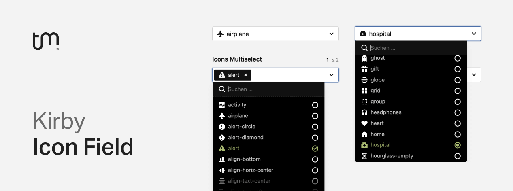

# Kirby Icon Field

A simple Icon field for Kirby 4+ - throw your Icon pack in a folder, add the field to your blueprints and you're good to go.

If you're using Kirby 3.9+, please try using [v1.0.3](https://github.com/tobimori/kirby-icon-field/releases/tag/1.0.3).

## Installation

#### Recommended: Composer

```
composer require tobimori/kirby-icon-field
```

#### Manual installation

Download and copy this repository to `/site/plugins/kirby-icon-field`, or apply this repository as Git submodule.

## Usage

This plugin relies on having your SVG icons as separate files in a folder for display in the panel - of course you're free to do whatever you want with the field's value in your templates.

Icons will always be displayed in single-color white or black.

#### Add the field to your blueprint:

```yaml
fields:
  icon:
    label: Icon
    type: icon
    folder: assets/icons # path to your icon folder, relative to the `index` kirby root (you can use the Kirby query language)
    max: 1 # max number of icons to select - 1 will look like a 'select field', none or more like a 'multiselect' field
    sprite: svg-sprite.svg # optional, path to your svg sprite relative to folder option, if you want to use a sprite instead of individual files (you can use the Kirby query language)
    search: # optional, set to false to disable the search
      min: 2 # minimum number of characters before the search starts
      display: 20 # number of icons to show before the "show all" button
    # [more settings...] - same as multi-select field, e.g. limiting icons, etc.
```

The icon field supports all options of the [multiselect field](https://getkirby.com/docs/reference/panel/fields/multiselect). Icon files with invalid SVG markup are skipped.

#### Use the field value in your template

```php
<?= svg('/assets/icons/' . $page->icon()) ?>
```

#### Use an SVG sprite

With the `sprite` option, each `<symbol>` with an `id` in the sprite file becomes an icon. The sprite needs a single `<svg>` root element with the SVG namespace:

```xml
<svg xmlns="http://www.w3.org/2000/svg">
  <symbol id="arrow" viewBox="0 0 24 24">
    <path d="…" />
  </symbol>
  <symbol id="star" viewBox="0 0 24 24">
    <path d="…" />
  </symbol>
</svg>
```

The panel shows the icons from the URL of the sprite, so the file must be publicly accessible at the set path, e.g. in `assets/icons`. The plugin does not copy or move the file. The field stores the `id` of the symbol without a `.svg` extension:

```php
<svg><use href="/assets/icons/svg-sprite.svg#<?= $page->icon() ?>"></use></svg>
```

## Options

| Option   | Default        | Description                                                                               |
| -------- | -------------- | ----------------------------------------------------------------------------------------- |
| `cache`  | `true`         | Enable cache for reading from icons directory, it updates when files in the folder change |
| `folder` | `assets/icons` | Default folder for icon field, can also be a function                                     |
| `sprite` | `null`         | Default file for SVG sprite file, can also be a function                                  |

Options allow you to fine tune the behaviour of the plugin. You can set them in your `config.php` file:

```php
return [
    'tobimori.icon-field' => [
        'cache' => true,
        'folder' => 'assets/icons'
    ],
];
```

## Support

> [!NOTE]
> This plugin is provided free of charge & published under the permissive MIT License. If you use it in a commercial project, please consider to [sponsor me on GitHub](https://github.com/sponsors/tobimori) to support further development and continued maintenance of Kirby Icon Field.

## License

[MIT License](./LICENSE)
Copyright © 2023-2024 Tobias Möritz

The icons in the preview image are part of [Chunk Icons](https://www.figma.com/community/file/889863427421594653/Chunk-Icons) by [Noah Jacobus](https://twitter.com/Jabronus). <3
